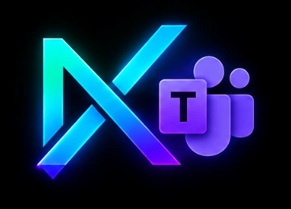

<p align="center">
  
</p>

<h1 align="center">NX Matrix AI — Microsoft Teams AI Bot</h1>

<p align="center">
  <strong>Connect Microsoft Teams-compatible chat to Ollama or an OpenAI-compatible AI model.</strong>
</p>

<p align="center">
  <a href="https://ns-matrix.github.io/nxmatrix-teams-ai">Project Guide</a> · <a href="https://github.com/ns-matrix/nxmatrix-teams-ai/actions">CI Checks</a> · <a href="https://github.com/ns-matrix/nxmatrix-teams-ai/issues">Report an Issue</a>
</p>

A Windows-first Python bot that connects Microsoft Teams-compatible chat to **Ollama** or another **OpenAI-compatible Chat Completions API**.

> **Start here:** This guide is written for Windows 10/11 and Command Prompt (CMD). You can run the bot locally with Agents Playground before configuring a real Microsoft Teams deployment.

[Project website & visual guide](docs/index.html) · [Source code](https://github.com/ns-matrix/nxmatrix-teams-ai) · [Report a bug](https://github.com/ns-matrix/nxmatrix-teams-ai/issues)

---

## What it does

- Receives chat activities through the Microsoft Teams SDK.
- Sends prompts to a configurable language model API.
- Supports local Ollama and compatible hosted API providers.
- Includes Windows setup and launch scripts.
- Includes an API connectivity check, configuration checks, and unit tests.
- Supports an optional development tunnel for an authenticated bot.

## Before you begin

Install:

- **Windows 10 or 11**
- **Python 3.12+**, available as `python` in Command Prompt
- **Git** (or download the repository ZIP)
- **Ollama** with a model downloaded, or an OpenAI-compatible API URL, API key, and model name
- **Microsoft Dev Tunnels CLI** only if you need a temporary HTTPS tunnel

A local Agents Playground session is not the same as deploying an app to the real Teams client. Real Teams deployment requires a suitable Microsoft 365 work/school tenant, bot registration, valid credentials, a Teams app package, and a publicly reachable HTTPS messaging endpoint.

---

## Quick start (recommended)

### 1. Download the project

Open **Command Prompt** and run:

```bat
git clone https://github.com/ns-matrix/nxmatrix-teams-ai.git
cd nxmatrix-teams-ai
```

Alternatively, use **Code → Download ZIP** on GitHub and extract the archive.

### 2. Run the setup wizard

```bat
setup.bat
```

The script creates a local `.venv`, installs dependencies, and creates `.env` from `.env.example` if it does not already exist. Existing `.env` settings are preserved.

### 3. Check your model

For Ollama, open or keep Ollama running, then use Command Prompt:

```bat
ollama list
ollama pull qwen2.5:3b
```

If the model is already listed, you do not need to download it again.

### 4. Configure the local test mode

Open the project's `.env` file in Notepad. The default provider configuration is:

```dotenv
API_BASE_URL=http://127.0.0.1:11434/v1
API_KEY=ollama
API_MODEL=qwen2.5:3b
API_TIMEOUT_SECONDS=120
BOT_PORT=3978
```

For **local Agents Playground testing only**, enable the explicit local authentication bypass in `.env`:

```dotenv
DANGEROUSLY_ALLOW_UNAUTHENTICATED_REQUESTS=true
```

This bypass is only for a bot bound to localhost during local testing. **Never use this setting with a public tunnel or a real Teams deployment.** Do not expose Ollama's port 11434 to the internet.

### 5. Start the bot

For a guided launcher, run:

```bat
start_all.bat
```

Choose the local Agents Playground mode. Or start the bot directly:

```bat
run_local.bat
```

Keep the bot terminal open. The default messaging endpoint is:

```text
http://localhost:3978/api/messages
```

### 6. Send a test message

1. Open Microsoft 365 Agents Playground.
2. Configure it to use the local messaging endpoint shown above.
3. Send a message and confirm that the bot responds.
4. Stop the bot with **Ctrl+C** when you finish.
5. Remove or comment out the local authentication bypass before using a tunnel or deploying anywhere.

The exact Playground interface can vary by version.

---

## Choose the right workflow

| Goal | What to run | Notes |
|---|---|---|
| First-time setup | `setup.bat` | Creates the virtual environment and installs dependencies |
| Guided launcher | `start_all.bat` | Menu for local testing, authenticated bot, API check, and tests |
| Start the bot directly | `run_local.bat` | Uses settings from `.env` |
| Check the model API | `.venv\Scripts\python.exe check_api.py` | Requires a reachable configured provider |
| Run unit tests | Command shown in [Testing](#testing) | Uses mocked responses; no live model required |
| Temporary development tunnel | `run_tunnel.bat` | Authenticated development only; never use with the local bypass |

The launcher does **not** start a public tunnel automatically.

---

## Use a hosted API instead of Ollama

Open `.env` and enter the URL, key, and model identifier supplied by your provider. For example:

```dotenv
API_BASE_URL=https://api.openai.com/v1
API_KEY=your_real_api_key
API_MODEL=gpt-4o-mini
API_TIMEOUT_SECONDS=120
BOT_PORT=3978
```

Use the exact model name and compatible endpoint supported by your provider. The example is illustrative; provider availability and model access depend on your account.

**Keep API keys private.** Do not commit `.env`, put real keys in `.env.example`, or share keys in screenshots, issue reports, or chat logs. If a key is exposed, revoke it and create a replacement.

## Configuration reference

| Variable | Purpose | Example |
|---|---|---|
| `API_BASE_URL` | OpenAI-compatible API base URL | `http://127.0.0.1:11434/v1` |
| `API_KEY` | Provider API key; Ollama commonly uses a placeholder | `ollama` |
| `API_MODEL` | Model identifier | `qwen2.5:3b` |
| `API_TIMEOUT_SECONDS` | Request timeout in seconds | `120` |
| `BOT_PORT` | Local bot HTTP port | `3978` |
| `SYSTEM_PROMPT` | Instruction provided to the model | Your assistant instructions |
| `CLIENT_ID` | Registered bot/application ID | From bot registration |
| `CLIENT_SECRET` | Registered bot secret | Keep private |
| `TENANT_ID` | Microsoft Entra tenant ID | From your tenant |
| `DANGEROUSLY_ALLOW_UNAUTHENTICATED_REQUESTS` | Local emulator authentication bypass | `true` only for localhost testing |

The app uses the Chat Completions route and appends `/chat/completions` to `API_BASE_URL` unless it is already included.

## Real Microsoft Teams deployment

A successful local Playground test does **not** automatically install the bot in Teams. Real Teams deployment needs:

1. An eligible Microsoft 365 work or school tenant and permission to develop/deploy custom apps.
2. A registered bot/application identity and valid credentials.
3. A publicly reachable HTTPS messaging endpoint configured for that bot.
4. A valid Teams app manifest/package and the required app scopes.
5. Authentication configured with the registered application credentials.

For an authenticated bot, configure `CLIENT_ID`, `CLIENT_SECRET`, and `TENANT_ID` in your local `.env`, and leave the unauthenticated bypass unset or commented out.

A personal Microsoft account may not provide the tenant developer features needed for custom bot registration. If tenant authentication or a developer token is unavailable, resolve the tenant and permission requirements first.

References: [Microsoft Teams developer documentation](https://learn.microsoft.com/microsoftteams/platform/) · [Teams Developer Portal](https://dev.teams.microsoft.com/)

## Optional: temporary HTTPS tunnel

Use a tunnel only when you have an authenticated, registered bot. A tunnel makes your local service reachable remotely; it does not register or install a Teams app.

1. Configure valid `CLIENT_ID`, `CLIENT_SECRET`, and `TENANT_ID` values.
2. Remove or comment out `DANGEROUSLY_ALLOW_UNAUTHENTICATED_REQUESTS`.
3. Start the bot and keep its terminal open.
4. In a second Command Prompt, run `run_tunnel.bat`.
5. Configure the registered messaging endpoint as `https://YOUR-TUNNEL-HOST/api/messages`.
6. Keep both terminals open and stop the tunnel when finished.

The tunnel URL should be treated as public and may change. Never expose Ollama's port 11434. Use properly secured hosting for production.

## Testing

Run these commands from the repository root after setup:

```bat
.venv\Scripts\python.exe check_api.py
.venv\Scripts\python.exe -m compileall -q src check_api.py tests
.venv\Scripts\python.exe -m unittest discover -s tests -v
.venv\Scripts\python.exe -m pip check
```

- `check_api.py` sends a request to the configured provider, so that provider must be running/reachable.
- Unit tests mock model responses and do not require a live API.
- `compileall` checks Python syntax.
- `pip check` checks installed dependency compatibility.

## Troubleshooting

### Ollama connection refused
Confirm Ollama is running, check `ollama list`, and verify `API_BASE_URL`. Make sure the requested model is installed.

### API returns HTTP 401 or 403
Check the API key, provider account permissions, and model access. Do not paste the key into public logs.

### API returns HTTP 404
Verify the base URL and model identifier. The provider must support OpenAI-compatible Chat Completions.

### Bot reports missing Teams credentials
For localhost Playground tests, use the explicit local-only bypass. For a tunnel or real Teams, configure valid registered bot credentials instead.

### Browser shows 404 at the root URL
The bot is a messaging endpoint, not a web chat page. Use `/api/messages` with Agents Playground; the root URL is not expected to display a chat UI.

### Tunnel cannot connect
Start the bot first, then start the tunnel in a separate terminal. Confirm the tunnel's port matches `BOT_PORT`.

### Dependencies or startup are broken
Run:

```bat
.venv\Scripts\python.exe -m pip check
.venv\Scripts\python.exe -m pip install -r requirements.txt
```

If the virtual environment is corrupted, close the bot, preserve your local `.env`, delete `.venv`, and run `setup.bat` again.

## Security checklist

- [ ] Keep `.env` and all credentials out of commits.
- [ ] Never use unauthenticated mode on a public endpoint.
- [ ] Never expose Ollama's port 11434 publicly.
- [ ] Treat temporary tunnel URLs as public.
- [ ] Rotate any credential that was exposed; `.gitignore` does not erase secrets from Git history.
- [ ] Use secured, monitored hosting for production workloads.

## Project structure

```text
nxmatrix-teams-ai/
├── .github/workflows/       # Automated Python validation
├── assets/                  # Project artwork
├── docs/index.html          # Visual setup guide and project hub
├── src/main.py              # Bot and LLM integration
├── tests/                   # Unit tests
├── .env.example             # Safe configuration template
├── check_api.py             # Live provider connectivity check
├── check_tunnel_config.py   # Tunnel configuration guard
├── requirements.txt         # Python dependencies
├── run_local.bat            # Start the bot
├── run_tunnel.bat           # Optional development tunnel
├── setup.bat                # Setup menu
├── start_all.bat            # Guided launcher
└── README.md                # This guide
```

## License

See [LICENSE](LICENSE).
